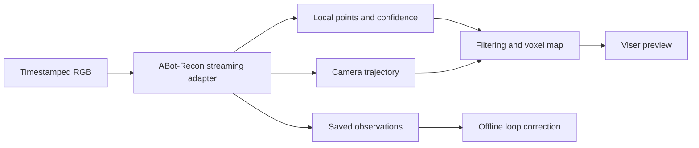

# ABot Realtime Map

Streaming monocular 3D mapping experiments with [ABot-Recon](https://github.com/amap-cvlab/ABot-Recon), featuring live point-cloud visualization, timestamped replay, and indoor/driving benchmarks.

This is an independent research project built on AMAP CV Lab's ABot-Recon. The upstream model provides geometry and camera poses; this repository adds a frame-at-a-time adapter, bounded map previews, archival, browser measurements, and evaluation tools.

> **License scope:** project code is Apache-2.0 except where a file states otherwise. **ABot-Recon weights are CC BY-NC 4.0.** Optional cuRoPE and MASt3R-SLAM components have additional non-commercial/share-alike terms. The code license does **not** grant commercial rights to these weights or components. Read [Licensing](#licensing) and [third-party notices](THIRD_PARTY_NOTICES.md) before use.

## What it does

- Replays monocular RGB at source timestamps without dropping selected frames to hide backlog.
- Produces incremental colored point clouds and camera-to-world poses.
- Streams CPU outputs while keeping dense historical predictions off the GPU.
- Displays a bounded voxel map in Viser; saves dense observations and independent road chunks.
- Exports PLY, timestamped trajectories, stage timings, memory statistics, and offline evaluations.
- Runs the upstream loop-closure module **after replay** and compares saved results.



**Scale is uncalibrated during inference.** This is a colored geometry prototype: online loop closure, dynamic-object removal, metric-scale navigation, and photorealistic rendering are not implemented.

## Measured status

These application measurements used one GPU reported as an RTX 4090, 504×280 input, BF16, FlashInfer paged attention, and cuRoPE.

| Sequence | Input | Browser latency P95 | Trajectory ATE RMSE, raw → offline loop |
|---|---|---:|---:|
| TUM `freiburg1_room` | 454 frames, sampled at 10 Hz | **0.758 s** | 0.1009 → 0.1009 m |
| KITTI 05 | 2.21 km, 2,761 frames, native 9.599 Hz | **1.268 s** | 13.53 → 5.99 m |
| KITTI 02 | 5.07 km, 4,661 frames, native 9.643 Hz | **0.310 s** | 70.40 → 38.97 m |

Browser latency includes rendered-image return time. Indoor measurement used a 500,000-point budget at 1280×800; driving used 200,000 points per chunk at 960×600. Indoor ATE comes from the quality run; the 500,000-point run establishes the displayed latency. ATE uses a separate whole-trajectory Sim(3) fit for each result, with ground truth used only offline.

KITTI 05 misses the one-second P95 target. Neither KITTI run establishes strict 10 Hz performance. Offline loop correction leaves substantial drift, and the final inner solver did not converge. See [indoor results](RESULTS.md), [driving results](DRIVING_RESULTS.md), and [aggregate benchmark data](docs/benchmark-summary.json).

## Setup

The tested inference environment is Linux, Python 3.12, PyTorch 2.5.1 / CUDA 12.1, and an NVIDIA GPU. Peak inference allocation was about 7.3 GiB; this is not a minimum-hardware guarantee. CPU-only installation supports tests and saved-result inspection.

```bash
git clone https://github.com/CaMi1le/abot-realtime-map.git
cd abot-realtime-map

# Install the pinned upstream code and environment, without downloading assets.
REALTIME_MAP_SKIP_DOWNLOAD=1 bash scripts/setup.sh
```

Review the [model terms](licenses/ABot-Recon/MODEL_LICENSE.md) and [TUM dataset terms](https://cvg.cit.tum.de/data/datasets/rgbd-dataset) before downloading. This command downloads the pinned checkpoint and the three TUM sequences used here:

```bash
.venv/bin/python scripts/download.py
```

The source commit is `6e3b2e1257464a74dfceff22eb33190bd228276e`. The checkpoint revision is `c69c26ca1853afc9c9212014459e729d7339ecdf`; SHA256 is `ea41a7659f6087069e6b3aac8830cc1c62d7c4a5c27a7d2679b51ba97cabcd2e`. The downloader verifies that hash. Upstream source, weights, data, and generated artifacts are excluded from Git.

The default attention path is SDPA. The measured faster profile uses optional acceleration:

```bash
# Tested with an Ada GPU (SM 8.9), CUDA toolkit, and GCC/G++ 12.
# cuRoPE is CC BY-NC-SA 4.0; see THIRD_PARTY_NOTICES.md.
bash scripts/setup-acceleration.sh
```

This builds cuRoPE and runs a short GPU parity check using the downloaded desk sequence. Build helpers target SM 8.9 by default; review compiler and architecture settings for other hardware. Setup without `REALTIME_MAP_SKIP_DOWNLOAD=1` also downloads TUM, the main checkpoint, and optional loop assets.

## Indoor replay

Run from the repository root, using a new output directory:

```bash
.venv/bin/realtime-map --input data/rgbd_dataset_freiburg1_room --output artifacts/my-room --attention sdpa --fps 10 --realtime --viewer --keep-open
```

Open `http://127.0.0.1:8890`. Use `--attention paged` after installing acceleration. Add `--measure-browser` for end-to-end measurement: replay then waits for a browser connection. After completion, Ctrl+C stops the retained viewer; saved results remain.

For a remote GPU, forward the loopback-only viewer using your own SSH configuration:

```bash
ssh -N -L 8890:127.0.0.1:8890 user@gpu-host
```

On an unmanaged shared server, `scripts/on-gpu.py -- COMMAND...` selects an idle GPU by UUID and holds a project-local lock. It does not replace a cluster scheduler or reserve the device against other users.

For your own video:

```bash
.venv/bin/python scripts/prepare-video.py video.mp4 data/my-video
.venv/bin/realtime-map --input data/my-video --output artifacts/my-video --fps 10 --realtime --viewer --keep-open
```

Video extraction and model loading precede measured replay. Runtime timing includes image loading, preprocessing, inference, mapping, archival, and browser delivery.

## Front-facing driving camera

Review the [KITTI terms](https://www.cvlibs.net/datasets/kitti/) before downloading. Only rectified front-left RGB (`image_2`) enters the model; every native timestamp is preserved. Calibration and ground truth are used solely offline.

```bash
# Selected members of the official public archive, with CRC checks.
.venv/bin/python scripts/download-kitti.py --sequences 05 02

.venv/bin/realtime-map --input data/kitti/dataset/sequences/05 --dataset-format kitti --output artifacts/my-kitti05 --attention paged --point-stride 4 --max-points 200000 --chunk-frames 100 --follow-camera --viewer --measure-browser --render-width 960 --render-height 600 --realtime --keep-open

.venv/bin/python -m realtime_map.kitti artifacts/my-kitti05 data/kitti/dataset/sequences/05
.venv/bin/python scripts/view-driving.py artifacts/my-kitti05 --port 8892
```

The live chase view displays the **current 100-frame chunk**, replacing the previous chunk at each boundary (about 10.4 seconds on these sequences). Background points can disappear during this reset even though earlier chunks remain on disk. The saved viewer offers current-chunk, neighboring-chunk, and whole-route views. Whole-route maps are coarser bounded previews.

## Browser measurement and recording

Install Node.js 20 or later, then:

```bash
npm ci --ignore-scripts
npx playwright install chromium ffmpeg

# Run while a driving replay is waiting for its browser.
REALTIME_MAP_WIDTH=960 REALTIME_MAP_HEIGHT=600 node scripts/browser-check.cjs http://127.0.0.1:8890 artifacts/browser-my-kitti05 600
```

For the indoor profile, omit the dimension variables to use 1280×800. `CHROMIUM_EXECUTABLE` selects an installed Chrome binary. `REALTIME_MAP_SOFTWARE_RENDER=1` enables software rendering; report that condition separately. The harness launches Chromium with `--no-sandbox`; use it only with the trusted local viewer.

Latency spans scheduled frame arrival through the rendered browser image returned to the server. It includes the return trip and is not physical screen scanout time. The first 12 replay frames are excluded from percentiles but retained in logs. Every measured frame must receive an acknowledgment or explicit error. Recordings preserve wall-clock timing, including backlog, without speed changes.

## Outputs and offline evaluation

| Output | Meaning |
|---|---|
| `frames/*.npz` | Dense local points, RGB, confidence, poses, timestamps; disabled by `--no-dense` |
| `map.ply`, `map.npz` | Bounded voxel overview |
| `map-chunks/` | Independent detailed sections when chunk archival is enabled |
| `poses.npy`, `timestamps.txt`, `trajectory.txt` | Trajectory in uncalibrated model units |
| `timings.jsonl`, `browser-acks.json`, `report.json` | Timing, memory, input coverage, pass/fail |
| `evaluation*.json` | Offline trajectory and applicable geometry metrics |
| `map-loop.*`, `poses-loop.npy`, `loop/` | Optional post-run loop correction |

Confidence defaults to 0.5, pixel stride to 3, and preview capacity to 500,000 points. Voxel size defaults to first-frame median predicted depth divided by 150; `--voxel` specifies model units. Maps coarsen at their point budget. Dense disk usage grows with input length.

```bash
.venv/bin/python -m realtime_map.evaluation artifacts/my-room data/rgbd_dataset_freiburg1_room

# Review third-party checkpoint terms before fetching optional loop assets.
.venv/bin/python vendor/ABot-Recon/scripts/download_loop_assets.py --output-dir models/loop
.venv/bin/python scripts/refine-saved.py artifacts/my-room --attention paged
.venv/bin/python scripts/view-result.py artifacts/my-room --port 8891
```

Loop correction needs the original inputs and saved dense observations and is excluded from realtime acceptance. `scripts/diagnose-driving-loop.py RUN...` analyzes saved driving trajectories and loop pairs against ground truth without rerunning inference.

Indoor geometry scores cover sampled observations with valid depth and sufficient confidence. KITTI segment scores are computed after global scale alignment and are **not official metric-scale leaderboard scores**.

## Development

```bash
# CPU-only tests and saved-result tools; no model download required.
python3 -m venv .venv-test
.venv-test/bin/pip install -e '.[analysis]'
.venv-test/bin/pytest -q
```

| Code | Purpose |
|---|---|
| [backend.py](src/realtime_map/backend.py) | Stateful frame-at-a-time adapter and CPU outputs |
| [runner.py](src/realtime_map/runner.py) | Timestamped replay, archival, measurement |
| [mapping.py](src/realtime_map/mapping.py) | Filtering, voxel maps, independent chunks |
| [viewer.py](src/realtime_map/viewer.py) | Live Viser preview and browser acknowledgments |
| [kitti.py](src/realtime_map/kitti.py) | Driving input and offline evaluation |
| [scripts/](scripts/) | Download, parity, visualization, experiment tools |

See [optional MASt3R-SLAM comparison](docs/comparison.md) for the separate baseline environment and its licenses. Generated maps, source images, recordings, raw logs, checkpoints, and server-specific helpers are not distributed with this source repository. Aggregate historical measurements are included; rerunning the tools produces new local artifacts.

## Licensing

- **Project code:** [Apache License 2.0](LICENSE), except the explicitly marked MASt3R-SLAM adaptation script. Attribution and adaptation details are in [NOTICE](NOTICE).
- **ABot-Recon source:** Apache-2.0 overall, with file-specific third-party exceptions. The adapter follows pinned upstream inference; the upstream checkout remains separate under ignored `vendor/`.
- **ABot-Recon weights:** [CC BY-NC 4.0](licenses/ABot-Recon/MODEL_LICENSE.md). Preserve ABot-Recon/Pi3 attribution and applicable Pi3 terms. Commercial use requires separate written authorization from all relevant rights holders.
- **Optional cuRoPE and MASt3R-SLAM:** CC BY-NC-SA 4.0 for the identified components; their checkpoints have independent terms. This repository does not relicense them.
- **Datasets and other checkpoints:** original terms apply independently. Public download availability does not replace those terms.

[Third-party notices](THIRD_PARTY_NOTICES.md) identify sources, versions, exceptions, and retained notices. No model weights or datasets are distributed here. This independent project does not imply endorsement by upstream authors.
